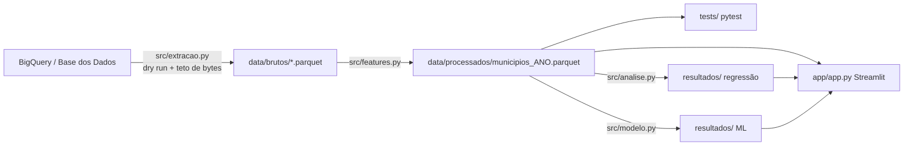

# O que explica a abstenção

Autor: Deyvid Prado.

Análise estatística e modelo de machine learning sobre a abstenção eleitoral nos municípios brasileiros: extração do BigQuery (Base dos Dados) para Parquet, testes de dados com pytest, regressão linear com statsmodels, modelos de árvores com scikit-learn e um app em Streamlit que roda sobre os arquivos locais.

Versão 1, 04/11/2026: pipeline completo executado do zero, 25 testes aprovados (21 de dados e 4 do I de Moran), app verificado.

## Pergunta

Que características do município acompanham a taxa de abstenção nas eleições gerais? A análise mede associação. Nenhum resultado aqui mostra que uma característica causa abstenção.

## Fonte

| Dado | Tabela na Base dos Dados | Ano |
|---|---|---|
| Aptos, comparecimento e abstenções por zona | `br_tse_eleicoes.detalhes_votacao_municipio_zona` | 2018 e 2022 |
| Conferência da soma por município | `br_tse_eleicoes.detalhes_votacao_municipio` | 2018 e 2022 |
| Idade, escolaridade e gênero do eleitorado | `br_tse_eleicoes.perfil_eleitorado_municipio_zona` | 2018 e 2022 |
| PIB municipal | `br_ibge_pib.municipio` | 2018 e 2022 |
| População de 2018 | `br_ibge_populacao.municipio` | 2018 |
| População e área | `br_ibge_censo_2022.municipio` | 2022 |
| Nome, região e centroide | `br_bd_diretorios_brasil.municipio` | |

Os dados originais são do TSE e do IBGE. O projeto consome as tabelas já publicadas pela Base dos Dados e não faz ingestão dos arquivos originais. Nomes de tabelas e colunas foram conferidos no `INFORMATION_SCHEMA` antes do uso. Validação completa: [`docs/validacao-fonte.md`](docs/validacao-fonte.md).

## Recorte

| Dimensão | Escolha | Motivo |
|---|---|---|
| Nível | município | as variáveis explicativas existem nesse nível para o país inteiro |
| Eleição | 2022, com 2018 como comparação | eleições gerais mais recentes |
| Turno | 1º | todos os municípios votam |
| Cargo | presidente | a fonte repete aptos e comparecimento por cargo; fixar um cargo evita contar o eleitor várias vezes |
| Tipo de eleição | ordinária | a fonte inclui eleições suplementares |
| Exterior | excluído | não pertence a município |

Uma linha da tabela final é um município em um ano: 5.570 linhas em 2022 e 5.570 em 2018. O único município do diretório que fica de fora é Boa Esperança do Norte (MT), que não teve votação em nenhuma das duas eleições.

A abstenção de Brasília calculada aqui (18,7025% em 2018 e 17,5395% em 2022) é igual à do DF medida no projeto anterior, [Eleições em Dados](https://github.com/Deyv7/eleicoes-em-dados).

## Arquitetura



Depois da extração nada mais consulta o BigQuery. O app lê só os Parquet e os arquivos de `resultados/`. Os arquivos são pequenos (1,7 MB em `data/brutos/`, 2,1 MB em `data/processados/` e 1,3 MB em `resultados/`), então estão versionados e o app roda sem credenciais do Google.

## Variáveis

| Variável | Definição |
|---|---|
| Abstenção (alvo) | abstenções / aptos, em pontos percentuais |
| % com 16 ou 17 anos | eleitores de 16 e 17 anos / eleitores do perfil |
| % com 70 anos ou mais | eleitores de 70 anos ou mais / eleitores do perfil |
| % feminino | eleitoras / eleitores do perfil |
| % analfabeto ou lê e escreve | instrução 1 ou 2 / eleitores do perfil |
| % com superior completo | instrução 8 / eleitores do perfil |
| Eleitorado apto | log na base 2 dos aptos |
| PIB per capita | log na base 2 de PIB / população |
| Eleitores aptos por habitante | aptos / população |
| Densidade demográfica | log na base 2 de população / área (km²) |
| Região | Norte, Nordeste, Centro-Oeste, Sudeste (referência), Sul |

Em 2022 a população vem do Censo 2022. Em 2018, de `br_ibge_populacao.municipio`. A área é a do Censo 2022 nos dois anos. Com log na base 2, o coeficiente é o que muda quando a variável dobra.

## Decisões

- Cargo, turno e tipo de eleição são filtrados na consulta, antes de somar as zonas. Sem o filtro, o 1º turno de 2022 soma 778.687.320 aptos; com ele, 155.758.656.
- A divergência de 84 eleitores em Manaus (zona 68, 2022), que já vem da fonte, foi mantida e documentada. O teste de conciliação aceita só essa exceção.
- O erro padrão principal é agrupado por UF. Os resíduos de municípios do mesmo estado são correlacionados (a UF explica 18,6% da variação dos resíduos em 2022), e o HC3 só corrige variância desigual. O HC3 aparece ao lado para comparação.
- O modelo de ML é avaliado com GroupKFold por UF, em que cada estado inteiro fica fora do treino. O KFold aleatório também é reportado.
- Cada município pesa igual. A pergunta é sobre municípios, e não sobre o eleitor médio.
- Seed 42 em todo sorteio. Os modelos de árvores usam parâmetros padrão, sem busca de hiperparâmetros.

Cada uma dessas escolhas está explicada em linguagem simples em [`docs/explicacao.md`](docs/explicacao.md).

## Testes de dados

`python -m pytest` roda 25 casos sobre os Parquet locais, sem BigQuery (21 de dados e 4 que conferem o cálculo do I de Moran em casos conhecidos):

| Teste | Verifica |
|---|---|
| Filtro da extração | só presidente, 1º turno, eleição ordinária, sem exterior |
| Zona única | cada par município/zona aparece uma vez |
| Município único | código IBGE único, com 7 dígitos |
| Cobertura | 5.570 municípios, 27 UFs, faltante só o da lista documentada |
| Taxas | abstenção entre 0 e 1; proporções entre 0 e 100 |
| Conciliação | aptos = comparecimento + abstenções, com a exceção documentada de Manaus |
| Tabela municipal | a soma das zonas bate com a tabela municipal da fonte |
| Nulos | nenhuma variável usada tem nulo ou infinito |
| Categorias do perfil | instrução e gênero somam o total de eleitores |
| Perfil e votação | eleitores do perfil entre 90% e 110% dos aptos |
| Agregação | a soma para quando recebe uma zona repetida (dado sintético) |

Os testes por ano rodam para 2022 e 2018.

## Custo no BigQuery

O projeto usa o BigQuery sandbox do projeto `eleitorado`, sem faturamento. `src/bq.py` faz dry run antes de cada consulta, recusa a consulta se a estimativa passar do teto, passa `maximum_bytes_billed` a todo job e registra estimativa, bytes processados e bytes faturados em `evidencias/consultas.jsonl`.

O teto padrão é 100 MB por job. A exceção é o perfil do eleitorado: a tabela tem cerca de 3 GB, e a menor leitura possível de um ano já passa de 100 MB (só `id_municipio` e `eleitores` de 2022 dão 108.729.810 bytes no dry run). Com as colunas de idade, instrução e gênero a leitura fica em torno de 160 MB, e esse job usa teto de 250 MB.

Execução do pipeline do zero (`python -m src.pipeline`):

| Job | Bytes estimados | Bytes processados | Bytes faturados | Teto |
|---|---|---|---|---|
| votação por zona 2022 | 3.861.128 | 3.861.128 | 10.485.760 | 100 MB |
| votação municipal 2022 | 3.117.880 | 3.117.880 | 10.485.760 | 100 MB |
| perfil do eleitorado 2022 | 161.075.702 | 161.075.702 | 161.480.704 | 250 MB |
| PIB e população 2022 | 7.834.844 | 7.834.844 | 20.971.520 | 100 MB |
| votação por zona 2018 | 3.911.637 | 3.911.637 | 10.485.760 | 100 MB |
| votação municipal 2018 | 3.153.691 | 3.153.691 | 10.485.760 | 100 MB |
| perfil do eleitorado 2018 | 154.399.523 | 154.399.523 | 155.189.248 | 250 MB |
| PIB e população 2018 | 7.834.844 | 7.834.844 | 20.971.520 | 100 MB |
| Censo 2022 | 161.530 | 161.530 | 10.485.760 | 100 MB |
| diretório de municípios | 467.100 | 467.100 | 10.485.760 | 100 MB |
| Total | | 345.817.879 | 421.527.552 | |

O BigQuery fatura no mínimo 10 MB por tabela consultada, por isso os bytes faturados passam dos processados nas consultas pequenas. Somando a exploração, a validação da fonte e as duas execuções completas da extração, o projeto rodou 34 jobs, com 777.253.300 bytes processados e 1.003.487.232 faturados.

## Resultados

Abstenção no 1º turno para presidente, fora do exterior: 20,79% no país em 2022 e 20,19% em 2018. Entre municípios, em 2022, a média foi 21,27%, com desvio padrão de 4,72 pontos, mínimo de 8,82% (Bela Vista do Piauí, PI) e máximo de 40,56% (Rio Vermelho, MG).

### Regressão linear

Em 2022 o modelo explica 43% da variação da abstenção entre municípios (R² = 0,430; ajustado 0,428). A UF sozinha explica 34,5%. Em 2018 o R² foi 0,576. O maior VIF foi 3,67 em 2022 e 3,88 em 2018, então as variáveis não se sobrepõem a ponto de prejudicar as estimativas.

Coeficientes em pontos percentuais de abstenção, erro agrupado por UF (t com 26 graus de liberdade). A coluna Q1 → Q3 mostra a mudança ao passar do 1º para o 3º quartil da variável, com as outras fixas.

| Variável | Coef. 2022 | IC 95% 2022 | p 2022 | Q1 → Q3 2022 | Coef. 2018 | p 2018 |
|---|---|---|---|---|---|---|
| % analfabeto ou lê e escreve | 0,22 | 0,14 a 0,30 | < 0,001 | +3,54 | 0,20 | < 0,001 |
| Eleitorado apto (dobra) | 1,10 | 0,78 a 1,42 | < 0,001 | +2,23 | 1,14 | < 0,001 |
| Densidade (dobra) | -0,69 | -0,97 a -0,41 | < 0,001 | -1,55 | -0,65 | 0,001 |
| % com 70 anos ou mais | 0,26 | 0,01 a 0,50 | 0,04 | +0,93 | 0,54 | < 0,001 |
| % com 16 ou 17 anos | -0,56 | -1,83 a 0,71 | 0,38 | -0,59 | -1,54 | < 0,001 |
| % feminino | 0,16 | -0,27 a 0,60 | 0,44 | +0,40 | -0,02 | 0,93 |
| % com superior completo | -0,07 | -0,20 a 0,06 | 0,30 | -0,33 | -0,42 | < 0,001 |
| PIB per capita (dobra) | -0,20 | -0,54 a 0,14 | 0,24 | -0,31 | 0,19 | 0,44 |
| Eleitores aptos por habitante | 0,73 | -2,62 a 4,09 | 0,66 | +0,11 | -0,72 | 0,58 |
| Nordeste (vs. Sudeste) | -4,65 | -6,59 a -2,70 | < 0,001 | | -4,19 | < 0,001 |
| Sul (vs. Sudeste) | -3,41 | -5,67 a -1,15 | 0,005 | | -4,80 | < 0,001 |
| Norte (vs. Sudeste) | -2,46 | -5,31 a 0,38 | 0,09 | | -1,63 | 0,20 |
| Centro-Oeste (vs. Sudeste) | 0,11 | -1,98 a 2,20 | 0,91 | | 0,46 | 0,71 |

Em linguagem simples, para 2022:

- Escolaridade é a associação mais forte. A cada ponto percentual a mais de eleitores analfabetos ou que só leem e escrevem, a abstenção é 0,22 ponto maior, em média, entre municípios parecidos no resto. Do 1º quartil (9,0% desses eleitores) ao 3º (25,3%), a diferença é de 3,5 pontos.
- Tamanho e densidade apontam em direções opostas. Com a mesma densidade, o município com o dobro de eleitores tem 1,1 ponto a mais de abstenção. Com o mesmo eleitorado, o município duas vezes mais denso tem 0,69 ponto a menos. As duas variáveis são correlacionadas (0,56), então essa leitura vale com uma fixa e a outra variando.
- Mais eleitores com 70 anos ou mais acompanha mais abstenção, mas em 2022 o intervalo quase toca o zero (p = 0,04). Em 2018 a associação foi o dobro e mais clara.
- Com as mesmas características, municípios do Nordeste têm 4,6 pontos a menos de abstenção que os do Sudeste, e os do Sul, 3,4 a menos.
- Jovens de 16 e 17 anos, mulheres, superior completo, PIB per capita e eleitores por habitante não mostraram associação clara em 2022. Superior completo e jovens mostraram em 2018. Comparo os dois anos lado a lado, sem modelar a mudança entre eles.

A escolha do erro padrão muda as conclusões. Com HC3, que supõe municípios independentes, quatro variáveis (16 ou 17 anos, mulheres, superior completo e PIB per capita) e a região Norte teriam p < 0,05 em 2022. Com o erro agrupado por UF, nenhuma delas tem.

Os resíduos têm variância desigual (Breusch-Pagan, estatística 267,9, p < 0,001) e se afastam pouco da normal (assimetria 0,31, curtose 3,42). Trocando região por efeito fixo de UF, o R² sobe para 0,54, e baixa escolaridade, 70 anos ou mais, eleitorado e densidade mantêm o sinal com p < 0,01.

### Modelo de ML

Previsão da abstenção de 2022, validação cruzada com 5 partes. MAE em pontos percentuais; métricas calculadas sobre as previsões fora da amostra dos 5.570 municípios.

| Modelo | MAE KFold | R² KFold | MAE GroupKFold por UF | R² GroupKFold por UF |
|---|---|---|---|---|
| Média | 3,75 | 0,000 | 3,80 | -0,030 |
| Regressão linear | 2,82 | 0,425 | 3,30 | 0,260 |
| Gradient boosting | 2,42 | 0,563 | 3,10 | 0,318 |
| Random forest | 2,42 | 0,561 | 3,06 | 0,326 |

Em 2018, com GroupKFold por UF: média MAE 5,05 e R² -0,026; regressão linear 3,67 e 0,442; gradient boosting 3,34 e 0,520; random forest 3,32 e 0,524.

Os modelos de árvores erram menos que a regressão linear nas duas validações. O ganho em relação ao KFold some em boa parte quando a UF inteira fica fora do treino: o R² do gradient boosting cai de 0,56 para 0,32. Parte do acerto do KFold vem de o modelo já ter visto municípios do mesmo estado. Para um estado que o modelo não viu, ele erra em média 3,1 pontos, contra 3,8 de quem chuta a média. O resultado é modesto: quase 70% da variação fica sem explicação nesse cenário. O R² também varia entre as partes (média 0,23, desvio 0,17 para o gradient boosting), conforme os estados que ficam de fora.

Importância por permutação do gradient boosting em 2022, medida nos estados de teste (quanto o MAE sobe, em pontos, quando a coluna é embaralhada): eleitorado apto 0,44; 70 anos ou mais 0,36; baixa escolaridade 0,25; região 0,24; densidade 0,16; 16 ou 17 anos 0,16; superior completo 0,09; feminino 0,06; eleitores por habitante 0,01; PIB per capita 0,01. Em 2018 superior completo ficou em primeiro (0,90).

## App

```bash
streamlit run app/app.py
```

O app tem quatro abas: mapa dos municípios e tabela por UF, distribuição da abstenção, efeitos da regressão e importância do modelo, e busca de município, que mostra a abstenção observada, a prevista pelo gradient boosting treinado sem a UF daquele município e as variáveis comparadas à mediana nacional. O mapa usa os centroides do diretório da Base dos Dados.

### Dependência espacial

Os resíduos da regressão de municípios vizinhos se parecem (`src/espacial.py`, 8 vizinhos mais próximos pelo centroide, 999 permutações):

| 2022 | Valor |
|---|---|
| I de Moran da abstenção | 0,636 |
| I de Moran dos resíduos | 0,475 (p = 0,001; o maior I entre os sorteios foi 0,022) |
| Com 5 e 10 vizinhos | 0,506 e 0,460 |
| Variação dos resíduos explicada pela média dos vizinhos | 46,0% (pela UF: 18,6%) |
| I dos resíduos depois de tirar a média da UF | 0,365 |
| Correlação com a média dos vizinhos de outra UF (1.309 municípios) | 0,29 (0,22 tirando a média de cada UF) |
| Distância até os 8 vizinhos | mediana de 27 km, média de 36 km |

O padrão atravessa as divisas, então há algo regional que as variáveis não medem. Duas checagens mostram que nenhuma associação do resultado principal desaparece:

- **Erro agrupado por grupos espaciais.** Grupos de municípios próximos formados pelas coordenadas, sem olhar a divisa: 27 e 60 grupos. Os valores-p usam t com G − 1 graus de liberdade, como na regressão principal, e ficam menores do que com a UF; por exemplo, 70 anos ou mais vai de 0,043 para 0,018 (27 grupos) e 0,0045 (60 grupos). As variáveis sem associação clara continuam sem. A exceção é a região Norte: de 0,087 com a UF para 0,071 com 27 grupos e 0,018 com 60. O agrupamento por UF segue como o principal por ser o mais conservador.
- **Validação cruzada com grupos espaciais.** Random forest com R² de 0,43 (27 grupos) e 0,45 (60 grupos), contra 0,33 no GroupKFold por UF. Deixar o estado inteiro de fora continua sendo a validação mais severa.

Em 2018 o I dos resíduos foi 0,433.

## Página de storytelling

`web/` tem uma versão narrada da análise, para ser lida rolando a página. Cada município é um ponto numa cena em three.js. Conforme a página desce, os pontos formam o mapa, ganham a cor da abstenção e se reorganizam em colunas por região e em gráficos de dispersão contra escolaridade, tamanho do eleitorado e idade. Depois a cor passa a mostrar o erro da regressão, e a página termina com uma busca por município.

- A rolagem é lida pelo GSAP ScrollTrigger, com Lenis para suavizar. A transição entre dois estados da cena é calculada a partir da posição do scroll, então subir e descer a página dá sempre o mesmo resultado.
- A entrada dos cartões, os contadores e os gráficos de coeficientes e de modelos são animados com Motion.
- Nenhum número que vem dos dados é escrito à mão no HTML; o HTML só fixa limiares e escalas (30%, 5%, a legenda de 10% a 35%). `src/exportar_web.py` lê `data/processados/` e `resultados/` e grava `web/public/dados/`, e a página preenche os textos a partir desses arquivos. O exportador confere que a soma sem filtro é 778.687.320 e a com filtro é 155.758.656.
- Com `prefers-reduced-motion`, a página não faz animações automáticas nem rolagem suavizada. Sem WebGL, o texto continua legível.

## Limitações

- São dados agregados por município. Uma associação entre o perfil do município e a abstenção não diz como uma pessoa vota (falácia ecológica).
- O modelo explica 43% da variação na regressão, e o melhor modelo de previsão (random forest) chega a 33% para estados não vistos. A maior parte da diferença entre municípios fica sem explicação com essas variáveis.
- 27 UFs é pouco para o erro agrupado. Os p-valores perto de 0,05 devem ser lidos com cuidado.
- Os resíduos têm dependência espacial que atravessa as divisas entre estados (I de Moran 0,475). Com o erro agrupado por grupos espaciais, nenhuma associação do resultado principal desaparece (e a região Norte passa a ter p < 0,05 com 60 grupos), mas o projeto não ajusta um modelo espacial.
- O perfil do eleitorado é uma fotografia do cadastro e não coincide exatamente com os aptos da votação (razão entre 0,94 e 1,03 por município em 2022).
- Os aptos de presidente ficam 201.153 acima dos de governador em 2022, sempre para cima e concentrados nas capitais. Não verifiquei a origem dessa diferença.
- PIB em valores correntes. A população de 2018 vem de uma série diferente da de 2022, e a área é a do Censo 2022 nos dois anos.
- As tabelas de IDH da Base dos Dados (`mundo_onu_adh`) aparecem sem linhas nos metadados, então o socioeconômico ficou em PIB per capita e densidade.
- 2018 e 2022 são comparados lado a lado; o projeto não modela a mudança de um ano para o outro.
- Os modelos de árvores não tiveram ajuste de hiperparâmetros.

## Como rodar

Pré-requisitos: Python 3.12 e, só para a extração, Google Cloud CLI com Application Default Credentials e um projeto com BigQuery. O código usa o projeto de cobrança `eleitorado`; troque `PROJETO_COBRANCA` em `src/bq.py` para usar outro.

PowerShell, na raiz do repositório:

```powershell
python -m venv .venv
.\.venv\Scripts\python.exe -m pip install -r requirements-lock.txt

# Sem BigQuery: usa os Parquet versionados em data/brutos/
.\.venv\Scripts\python.exe -m src.pipeline --sem-extracao

# Do zero, consultando o BigQuery (cerca de 346 MB processados)
gcloud auth application-default login
.\.venv\Scripts\python.exe -m src.pipeline

# Só os testes de dados
.\.venv\Scripts\python.exe -m pytest

# App
.\.venv\Scripts\streamlit.exe run app/app.py

# Consultas da validação da fonte (opcional, cerca de 19 MB processados)
.\.venv\Scripts\python.exe -m src.validar_fonte

# Página de storytelling (precisa de Node.js 20 ou mais novo)
.\.venv\Scripts\python.exe -m src.exportar_web
cd web
npm install
npm run dev        # desenvolvimento, em http://127.0.0.1:5173
npm run build      # versão estática em web/dist/
```

O pipeline roda, em ordem, extração, variáveis, testes, regressão, modelo e dependência espacial, e para se algum teste falhar. `requirements.txt` lista as dependências diretas com versão fixa; `requirements-lock.txt` tem o ambiente completo.

## Estrutura

```
src/
  bq.py             cliente do BigQuery com dry run, teto e registro de bytes
  extracao.py       consultas da extração para data/brutos/
  features.py       uma linha por município em data/processados/
  analise.py        regressão, VIF e resíduos (statsmodels)
  modelo.py         baselines, árvores, validação cruzada e permutação (scikit-learn)
  espacial.py       I de Moran dos resíduos, erro agrupado e validação por grupos espaciais
  pipeline.py       roda tudo em ordem
  validar_fonte.py  consultas da validação da fonte
  exportar_web.py   dados e resultados de 2022 para a página em web/
tests/              testes de dados e do I de Moran
app/app.py          app Streamlit
web/                página de storytelling (three.js, GSAP ScrollTrigger, Motion)
data/brutos/        Parquet extraídos do BigQuery
data/processados/   tabela final por município e ano
resultados/         coeficientes, VIF, métricas, importâncias e previsões
evidencias/         registro de todos os jobs e evidência da validação
docs/               validação da fonte e explicação das decisões
```

O projeto é independente e não tem vínculo com o TSE.
